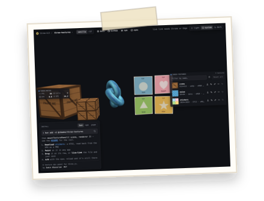
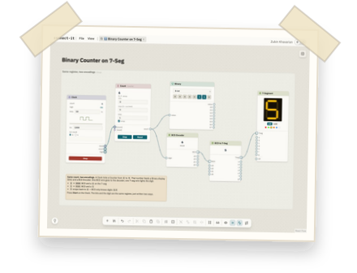
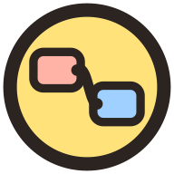
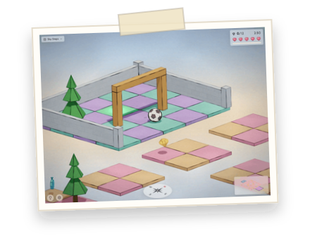
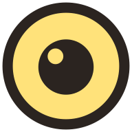
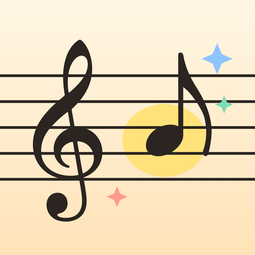

### Hey, I'm Zubin

I build highly interactive apps and 3D games for the web and native platforms (iOS and Android), and write about what I learn along the way. React, TypeScript, Three.js, game-dev, and AI-native engineering.

  <a href="https://zubin.dev">&nbsp;zubin.dev</a>
  &nbsp;·&nbsp;
  <a href="https://github.com/zkmake">&nbsp;GitHub</a>

---

## Open Source

More at [zubin.dev/open-source](https://zubin.dev/open-source/).

<a href="https://zkmake.github.io/three-kit/"><picture><source media="(prefers-color-scheme: dark)" srcset="assets/taped/three-kit-dark.png" /></picture></a>
 **[three-kit](https://zkmake.github.io/three-kit/)**  
three.js dev tools, each published on npm as `@zkmake/*`: a performance HUD, a live texture panel, a camera inspector, scene audits and draw-call batching. Vanilla three and React Three Fiber.  
[Open](https://zkmake.github.io/three-kit/) · [GitHub](https://github.com/zkmake/three-kit) · [npm](https://www.npmjs.com/org/zkmake)

 

---

## Projects

More at [zubin.dev/projects](https://zubin.dev/projects/).

<a href="https://connect-it-app.pages.dev/"><picture><source media="(prefers-color-scheme: dark)" srcset="assets/taped/connect-it-dark.png" /></picture></a>
 **[connect-it](https://connect-it-app.pages.dev/)**  
You place timers, QR codes, logic gates, displays, and music nodes on a canvas and draw wires between them. Values update on the edges as you edit. An extensive node library helps you find nodes and learn about each, and a starter template library comes with it. Inspired by Austin Griffith’s [eth.build](https://eth.build/), which I still think is amazing. React Flow.  
[Open](https://connect-it-app.pages.dev/)

 

&nbsp;

<a href="https://roll-it.pages.dev/"><picture><source media="(prefers-color-scheme: dark)" srcset="assets/taped/roll-it-dark.png" /></picture></a>
 **[roll-it](https://roll-it.pages.dev/)**  
WASD rolls a ball over floating tile islands while you collect gems. Rapier runs the physics. A sketch shader inks the world. When the ball rolls behind a wall or a tree, that scenery turns see-through. React Three Fiber + Three.js.  
[Play](https://roll-it.pages.dev/)

 

---

## Writing

A two-part series on the audio layer most web games skip.

**[Soundscapes for Web Games: The Layer Beneath Your SFX, Part 1](https://zubin.dev/blog/web-game-soundscapes-1-concepts/)**  
Web games sound flat because they treat audio as event SFX. A soundscape is the layer that fills the silence.

**[Soundscapes for Web Games: A Pluggable Howler Implementation, Part 2](https://zubin.dev/blog/web-game-soundscapes-2-howler/)**  
The soundscape engine is one class under a hundred lines. A six-function adapter is the seam.

More on [zubin.dev/blog](https://zubin.dev/blog/).

---

## Apps

Apps for iPhone, iPad and Apple Watch. More at [zubin.dev/apps](https://zubin.dev/apps/).

**[Treble Trouble](https://zubin.dev/apps/treble-trouble/)**  
Learn to read music, one small step at a time. Short lessons on the piano keys, treble and bass staff, and the beat, with a real piano sound and no timer or lives. Then famous tunes and timed games. 16 languages, no ads or tracking. iPhone and iPad, iOS 17 or later.  
[More](https://zubin.dev/apps/treble-trouble/)

<a href="https://apps.apple.com/us/app/treble-trouble-read-music/id6815917950"><picture><source media="(prefers-color-scheme: dark)" srcset="assets/apps/app-store-badge-white.svg" /></picture></a>

 

&nbsp;

**[Mahbanou (ماهبانو)](https://zubin.dev/apps/mahbanou/)**  
A Persian and Zoroastrian calendar. Solar Hijri, Gregorian and Iran's lunar Hijri side by side, plus the Shahenshahi, Kadmi, Fasli and Iranian (Bastani) calendars with roj, mah and gah times. Iran's public holidays and the Iranian and Zoroastrian feasts, the Nowruz countdown, a converter, widgets and reminders. Every date is checked against primary sources. Persian and English, free, no tracking. iPhone, iPad and Apple Watch.  
[More](https://zubin.dev/apps/mahbanou/)

<a href="https://apps.apple.com/us/app/mahbanou-persian-calendar/id6815880718"><picture><source media="(prefers-color-scheme: dark)" srcset="assets/apps/app-store-badge-white.svg" /></picture></a>

 
