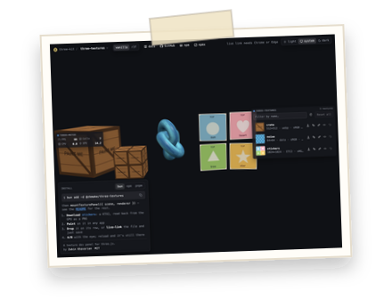
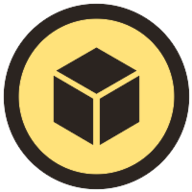
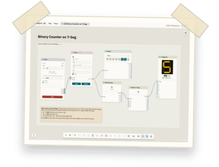
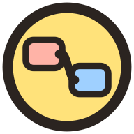
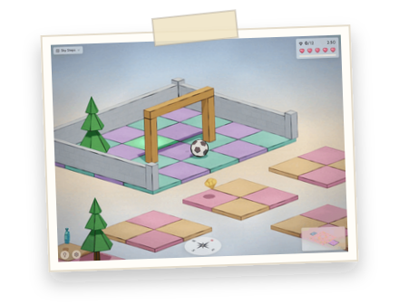
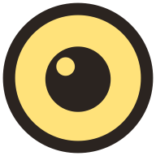
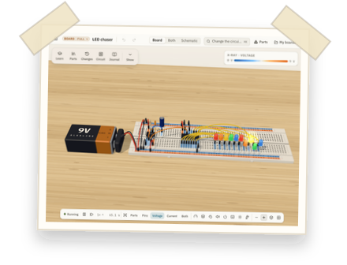

### Hey, I'm Zubin

I build learning apps and 3D games for the web and native apps (iOS and Android), and write about what I learn along the way. React, TypeScript, Three.js, game-dev, and AI-native engineering.

  <a href="https://zubin.dev">&nbsp;zubin.dev</a>
  &nbsp;·&nbsp;
  <a href="https://github.com/zkmake">&nbsp;GitHub</a>
  &nbsp;·&nbsp;
  <a href="https://x.com/zkmake">&nbsp;X</a>
  &nbsp;·&nbsp;
  <a href="https://www.linkedin.com/in/zubinkhavarian">&nbsp;LinkedIn</a>

---

## Open Source

Libraries I publish on npm. More at [zubin.dev/open-source](https://zubin.dev/open-source/).

<a href="https://zkmake.github.io/three-kit/"><picture><source media="(prefers-color-scheme: dark)" srcset="assets/taped/three-kit-dark.png" /></picture></a>
 **[three-kit](https://zkmake.github.io/three-kit/)**  
three.js dev tools, each published on npm as `@zkmake/*`: a performance HUD, a live texture panel, a camera inspector, scene audits and draw-call batching. Vanilla three and React Three Fiber.  
[Open](https://zkmake.github.io/three-kit/) · [GitHub](https://github.com/zkmake/three-kit) · [npm](https://www.npmjs.com/org/zkmake)

 

---

## Projects

Educational games and tools you can open in a browser. More at [zubin.dev/projects](https://zubin.dev/projects/).

<a href="https://connect-it-app.pages.dev/"><picture><source media="(prefers-color-scheme: dark)" srcset="assets/taped/connect-it-dark.png" /></picture></a>
 **[connect-it](https://connect-it-app.pages.dev/)**  
You place timers, QR codes, logic gates, displays, and music nodes on a canvas and draw wires between them. Values update on the edges as you edit. An extensive node library helps you find nodes and learn about each, and a starter template library comes with it. Inspired by Austin Griffith’s [eth.build](https://eth.build/), which I still think is amazing. React Flow.  
[Open](https://connect-it-app.pages.dev/)

 

&nbsp;

<a href="https://roll-it.pages.dev/"><picture><source media="(prefers-color-scheme: dark)" srcset="assets/taped/roll-it-dark.png" /></picture></a>
 **[roll-it](https://roll-it.pages.dev/)**  
WASD rolls a ball over floating tile islands while you collect gems. Rapier runs the physics. A sketch shader inks the world. When the ball rolls behind a wall or a tree, that scenery turns see-through. React Three Fiber + Three.js.  
[Play](https://roll-it.pages.dev/)

 

&nbsp;

<a href="https://breadboard-lab.pages.dev/"><picture><source media="(prefers-color-scheme: dark)" srcset="assets/taped/breadboard-lab-dark.png" /></picture></a>
 **[Breadboard Lab](https://breadboard-lab.pages.dev/)**  
Build electronics circuits on a realistic 3D breadboard and watch them run: LEDs light, a 555 blinks, buzzers sound, and parts burn out if you overdo it. A circuit simulator runs underneath, with X-ray views of voltage and current, a multimeter, and a schematic that draws itself as you build. Start from 34 ready-made templates or 37 parts, each explained with facts and links to learn more. React Three Fiber + Three.js.  
[Open](https://breadboard-lab.pages.dev/)

 

---

## Writing

A two-part series on the audio layer most web games skip.

**[Soundscapes for Web Games: The Layer Beneath Your SFX, Part 1](https://zubin.dev/blog/web-game-soundscapes-1-concepts/)**  
Web games sound flat because they treat audio as event SFX. A soundscape is the layer that fills the silence.

**[Soundscapes for Web Games: A Pluggable Howler Implementation, Part 2](https://zubin.dev/blog/web-game-soundscapes-2-howler/)**  
The soundscape engine is one class under a hundred lines. A six-function adapter is the seam.

More on [zubin.dev/blog](https://zubin.dev/blog/).
